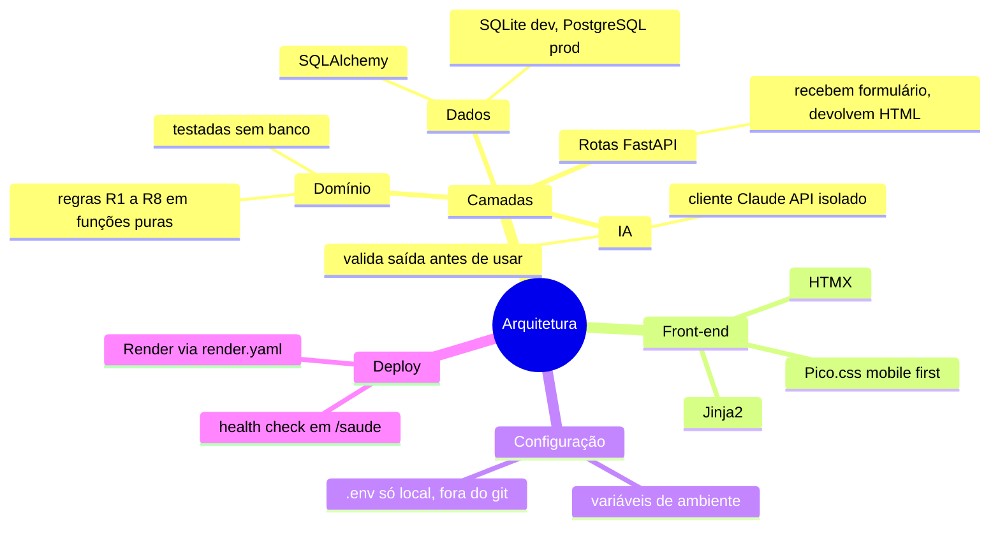
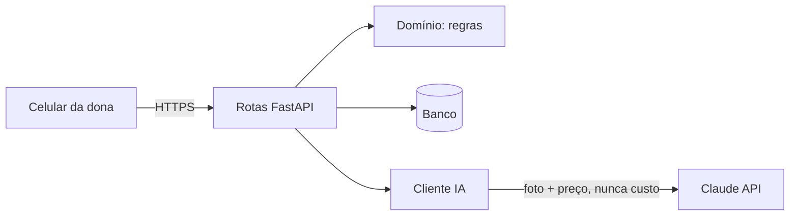

# Arquitetura



## Estrutura de pastas

```
app/
  main.py          # cria o FastAPI e registra as rotas
  config.py        # lê variáveis de ambiente
  templates/       # HTML (Jinja2)
  dominio/         # regras de negócio puras (Fase 4)
  db.py, modelos.py  # banco (Fase 4)
  ia/              # cliente do LLM (Fase 5)
tests/             # pytest
docs/              # progresso, ADRs, mapas
```

Princípio: **regras de negócio não conhecem banco nem HTTP.** Assim os testes das regras R1 a R8 rodam rápido e com valores calculados à mão.


