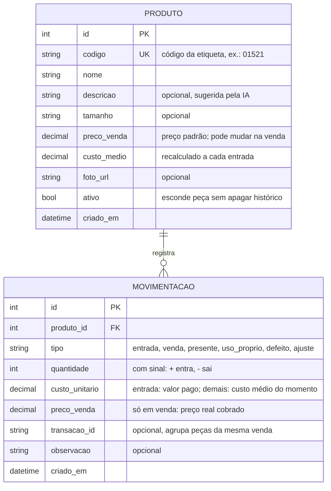

# Modelo de dados (v3)

## Regras de negócio

| # | Regra |
|---|---|
| R1 | **Saldo** = soma de `quantidade` das movimentações da peça. Nunca fica negativo: saída maior que o saldo é bloqueada. |
| R2 | **Sinal por tipo:** `entrada` > 0; `venda`, `presente`, `uso_proprio`, `defeito` < 0; `ajuste` ≠ 0. |
| R3 | **Custo médio** na entrada: `(saldo × custo_medio + qtd × custo_pago) ÷ (saldo + qtd)`. Sem arredondar no meio da conta. Saídas e ajustes não mudam o custo médio. |
| R4 | Toda saída e todo ajuste gravam em `custo_unitario` o custo médio do momento. |
| R5 | `preco_venda` na movimentação é obrigatório em `venda` e vazio nos demais tipos. |
| R6 | **Alerta:** base = quantidade da última `entrada`. Dispara quando saldo ≤ ⌈30% × base⌉. |
| R7 | **Lucro do mês** = Σ vendas `(preco_venda - custo_unitario) × unidades` - Σ perdas (`presente`, `uso_proprio`, `defeito`, `ajuste` negativo) `custo_unitario × unidades` + Σ ajustes positivos `custo_unitario × unidades`. |
| R8 | Peça não é apagada, só desativada (`ativo = false`), para não perder histórico. |

## Exemplos para testes (valores calculados à mão)

| Cenário | Esperado |
|---|---|
| 2 un. a R$ 15, entra 2 a R$ 18 | custo médio R$ 16,50 |
| 1 un. a R$ 15, entra 3 a R$ 18 | custo médio R$ 17,25 |
| custo médio R$ 16,50, vende 1 por R$ 50 | lucro da venda R$ 33,50 |
| saldo 5, venda de 6 | erro, saldo continua 5 |
| última entrada 4 | alerta com saldo ≤ 2 |
| última entrada 3 | alerta com saldo ≤ 1 |
