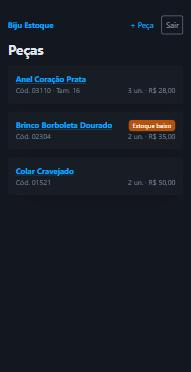
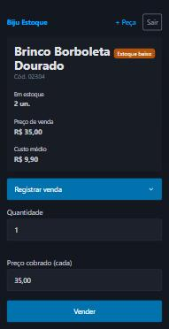
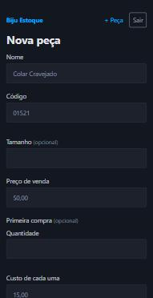
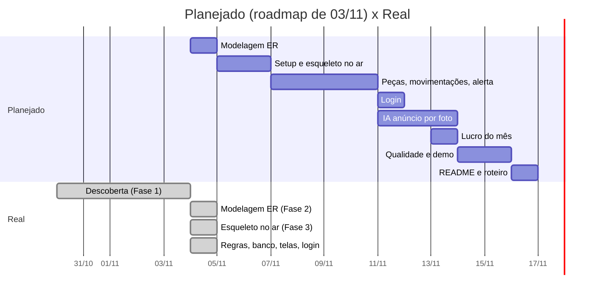
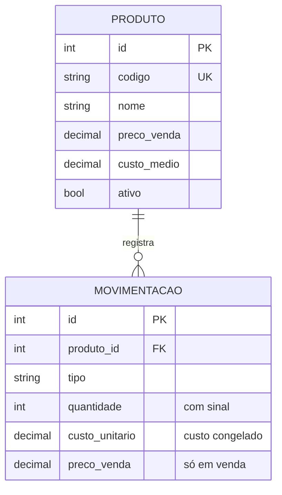
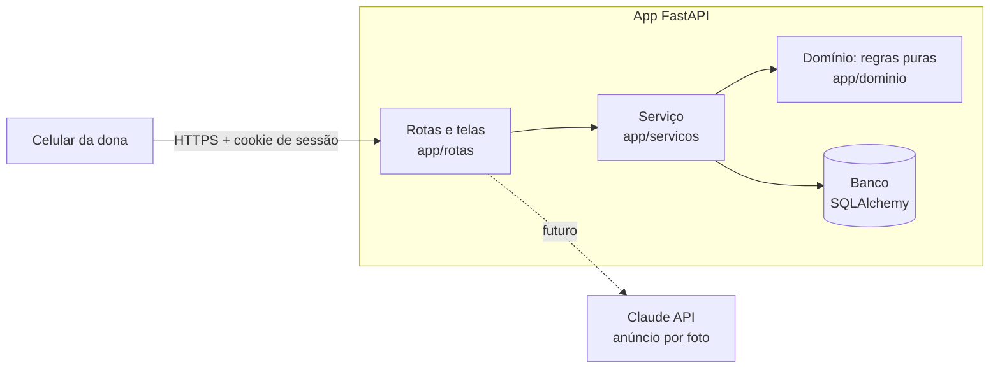
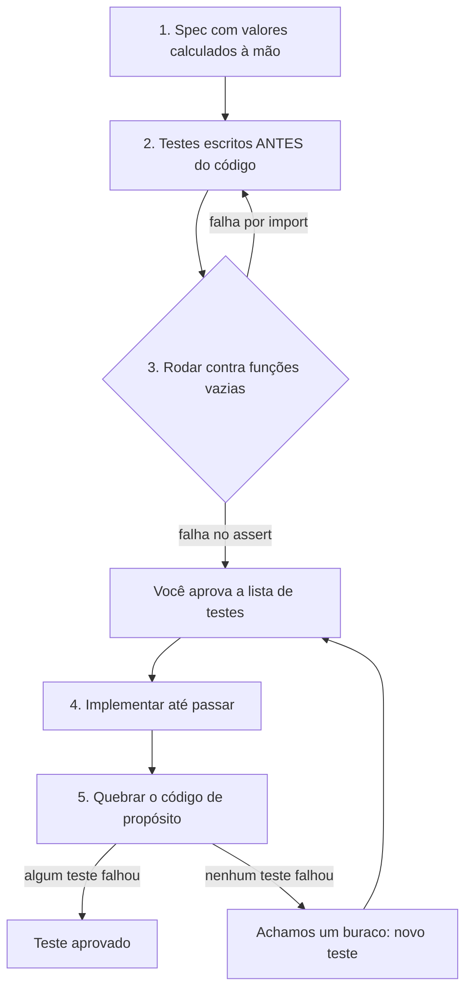

# Resumo do projeto até 04/11/2026

> **Em uma frase:** o sistema de estoque já está publicado e funcionando no celular (login, peças, compras, vendas, perdas, ajustes e alerta de estoque baixo), com 95 testes automáticos. Faltam o relatório de lucro, a IA de anúncio por foto e o banco definitivo em produção.

- **App no ar:** https://biju-estoque.onrender.com
- **Código:** https://github.com/SaIIex/Biju-Estoque
- **Prazo:** 17/11/2026 (faltam 13 dias)
- **Situação:** cerca de **6 dias adiantados** em relação ao roadmap

---

## 1. Como o sistema está hoje

| Lista de peças | Detalhe da peça | Cadastro |
|:---:|:---:|:---:|
|  |  |  |
| Selo **Estoque baixo** só na peça certa. O custo **não** aparece aqui (balcão). | Estoque, preço, custo médio, formulário de venda com preço editável e histórico. | Peça e primeira compra num formulário só, como no caderno. |

*Capturas do ambiente local com dados de exemplo, em tamanho de celular.*

**O que a dona já consegue fazer:** entrar com senha · cadastrar peça com a primeira compra · registrar compra nova (o custo médio recalcula sozinho) · vender com desconto · registrar presente, uso próprio ou defeito · corrigir o estoque na conferência · ver o histórico de cada peça com data e hora de Brasília · ver quais peças estão acabando.

---

## 2. Linha do tempo: planejado x real



---

## 3. O que foi feito, fase por fase

### Fase 1: Descoberta (30/10 a 03/11)
Levantamos os requisitos com perguntas em blocos e com o **caderno real da dona**.

| Descoberta | Consequência no sistema |
|---|---|
| Ela anota só nome e preço de venda | Para ter lucro, o sistema passa a guardar o **custo** de cada compra |
| O código da etiqueta (01521) parece esconder o custo | O custo é **dado sensível**: nunca aparece onde a cliente vê |
| Compra 1 a 4 unidades por vez na Shopee/Shein | Alerta em **30% da última compra, arredondado para cima** |
| Sai peça por venda, presente, uso próprio e defeito | Estoque guardado como **histórico de movimentações** |
| Usa no celular, no balcão | Telas **mobile first** e custo escondido na lista |

Entregas: requisitos priorizados ([MoSCoW](../mapas/requisitos.md)), [roadmap](../mapas/roadmap.md), [ADR 0001: IA anúncio por foto](../adr/0001-ia-anuncio-por-foto.md), [ADR 0002: stack](../adr/0002-stack.md) e as **regras de testes** no `CLAUDE.md`, propostas por você.

### Fase 2: Modelagem (04/11)
Duas tabelas e oito regras de negócio (R1 a R8) com exemplos calculados à mão. Detalhes em [modelo-dados.md](../mapas/modelo-dados.md).



### Fase 3: Esqueleto publicado (04/11)
Projeto Python com FastAPI, GitHub e deploy no Render com health check em `/saude`. Ideia central: **walking skeleton**, ou seja, publicar cedo uma versão mínima para descobrir problemas de deploy agora, e não na véspera.

### Fase 4: Implementação (04/11, em andamento)
Três camadas, cada uma testada antes de existir:



| Camada | O que faz | Testes |
|---|---|---|
| Domínio | custo médio, saldo, sinal por tipo, alerta | 33 |
| Serviço + banco | grava compras, vendas, perdas e ajustes aplicando as regras | 20 |
| Telas + login + dinheiro em R$ | formulários, login, conversão "15,50" ↔ 15.50 | 40 |
| Saúde | o app responde | 2 |
| **Total** | | **95** |

---

## 4. Como garantimos que os testes valem algo

A sua observação de que IA costuma gerar testes que sempre passam virou um método com quatro passos, repetido em toda entrega:



O passo 5 é o **teste de mutação** feito à mão, e ele achou **6 bugs que os testes não pegavam**:

| Etapa | Bugs aplicados | Pegos de primeira | Buraco encontrado | Teste criado |
|---|---|---|---|---|
| Domínio | 9 | 9 | nenhum | |
| Serviço | 10 | 8 | alerta usando a **primeira** compra; saldo somando **todas as peças** | S11b, S15 |
| Telas | 10 | 8 | venda gravando **sempre R$ 50**, ignorando o desconto; peça desativada na lista | M1b, P4 |
| **Final** | **29** | **29** | | |

O bug do "saldo somando todas as peças" e o do "desconto ignorado" estragariam o estoque e o lucro **sem nenhum aviso**. Todos os testes estavam verdes. Essa é a melhor história técnica do projeto para contar em entrevista.

---

## 5. Decisões tomadas (e por quê)

| Decisão | Motivo |
|---|---|
| Python + FastAPI | Linguagem dominante em vagas de AI Engineer; FastAPI espelha o ASP.NET Core |
| Estoque como histórico de movimentações | Rastreabilidade e lucro correto; o saldo nunca diverge do histórico |
| Lucro por CMV (custo das peças vendidas) | Mostra a margem real, sem distorcer pelo mês da compra |
| Custo médio ponderado com 4 casas, exibido com 2 | Dízimas (47 ÷ 3) sem erro acumulado de centavos |
| `Decimal` para dinheiro, nunca `float` | `0.1 + 0.2` em float dá `0.30000000000000004` |
| Custo congelado em cada venda | Comprar mais caro amanhã não muda o lucro de hoje |
| Peça sem nenhuma compra não alerta | "Estoque baixo" é "está acabando o que comprou" |
| Custo escondido na lista, visível no detalhe | A cliente pode ver a tela no balcão |
| Senha única em variável de ambiente; sem senha, ninguém entra | Simples para uma usuária; falha fechada |
| Comparação de senha em tempo constante | Evita ataque de tempo |
| Post/Redirect/Get em todo formulário | F5 não repete a venda |
| Lista branca de tipos em "outras saídas" | Impede venda sem preço por uma porta dos fundos |
| Serviço não faz commit, a rota faz | Nada fica gravado pela metade quando dá erro |

---

## 6. Pontos em aberto: preciso da sua decisão ou atenção

1. **⚠️ Banco de produção (urgente antes do uso real).** No Render gratuito, o SQLite é **apagado a cada deploy ou reinício**. O código já funciona com PostgreSQL; falta escolher **onde** hospedar (Postgres do próprio Render, Neon ou Supabase) e conferir os limites do plano gratuito de cada um. **Até lá, não cadastre o estoque real.**
2. **Mensagem de erro fora da vista no celular.** Depois de um erro num formulário (por exemplo, vender mais do que tem), a página volta rolada para baixo e o aviso vermelho fica no topo. Correção simples, ainda não feita.
3. **Confirmar com a dona:** como funciona o código da etiqueta (01521) e se ela faz trocas ou devoluções (hoje estão fora do MVP).
4. **Custo médio visível no detalhe da peça.** Você aprovou, mas vale perguntar à dona se ela abre o detalhe na frente da cliente. Se sim, dá para esconder atrás de um toque.
5. **Segurança para a Fase 6:** marcar o cookie como "só HTTPS" em produção e avaliar proteção CSRF além do `SameSite=lax` atual.
6. **Aviso do pytest** sugerindo trocar `httpx` por `httpx2`. Não troquei sem avaliar o pacote antes.
7. **Ritmo do estudo.** Você está no modo rápido. A pasta [`estudos/`](../../estudos/README.md) tem **17 arquivos comentados** em ordem de leitura; a lista do que ficou para depois está em [PROGRESSO.md](../PROGRESSO.md#aprendizado-adiado-pós-mvp).

---

## 7. Próximos passos

| Quando | O quê |
|---|---|
| Próxima sessão | Banco PostgreSQL em produção + correção da mensagem de erro |
| Em seguida | Relatório de **lucro do mês** (regra R7) |
| 08 a 11/11 | **IA: anúncio por foto** (Fase 5): foto entra, nome, descrição e texto do WhatsApp saem, sem nunca vazar o custo |
| 12 a 14/11 | Qualidade, segurança e **demo com a dona** |
| 15 a 16/11 | README, GIF e roteiro de 2 minutos para a entrevista |
| 17/11 | Folga e inscrição |

---

## 8. Vídeos para aprofundar

> Selecionei pelo título e pela descrição na busca; não assisti aos vídeos. Os em português vêm primeiro em cada tema.

### Ferramentas do projeto

**FastAPI** (o "ASP.NET Core" do Python), curso *FastAPI do Zero*, de Eduardo Mendes:
[](https://www.youtube.com/watch?v=-Pi5AmOfL2s)
Material escrito do curso: https://fastapidozero.dunossauro.com

**SQLAlchemy 2** (o "Entity Framework" do Python):
[](https://www.youtube.com/watch?v=t4C1c62Z4Ag)

**pytest** (o "xUnit" do Python):
[](https://www.youtube.com/watch?v=uVM9vPu2z0g)

**Deploy de FastAPI com PostgreSQL no Render** (o próximo passo; em inglês):
[](https://www.youtube.com/watch?v=nPUA8BLWzeY)

### Métodos de teste

**TDD: teste antes do código, com Python:**
[](https://www.youtube.com/watch?v=yqSx-G7Kr94)

**Teste de mutação** (o "quebrar o código de propósito"):
[](https://www.youtube.com/watch?v=zXM3TpHaaUk)

### Regras de negócio

**Custo médio ponderado:**
[](https://www.youtube.com/watch?v=xIXZVQvqZzo)

**CMV pelo custo médio ponderado (móvel e fixo).** O nosso é o **móvel**: recalcula a cada compra.
[](https://www.youtube.com/watch?v=GKhbgS0f42U)

**Por que dinheiro não pode ser `float`:**
[](https://www.youtube.com/watch?v=Z0otkBed7_I)

### Engenharia e processo

**Priorização MoSCoW:**
[](https://www.youtube.com/watch?v=WzTsnd2zyQg)

**ADR (registro de decisões de arquitetura)**, de André Secco:
[](https://www.youtube.com/live/5AjYSJrCnS0)
Continuação: [o que um ADR deve conter](https://www.youtube.com/watch?v=0RRITqhyvVU)

### Web e segurança (em inglês)

**Padrão Post/Redirect/Get** (por que o F5 não repete a venda):
[](https://www.youtube.com/watch?v=0O2HyhJE9L0)

**Ataque de tempo** (por que usamos `compare_digest` na senha):
[](https://www.youtube.com/watch?v=qKC3oH6-yQs)

---

## 9. Para retomar

```bash
.venv\Scripts\activate
```

```bash
uvicorn app.main:app --reload
```

```bash
pytest
```

Abra http://localhost:8000 (a senha local está no arquivo `.env`). Na próxima sessão eu leio o [PROGRESSO.md](../PROGRESSO.md) e retomo daqui.
